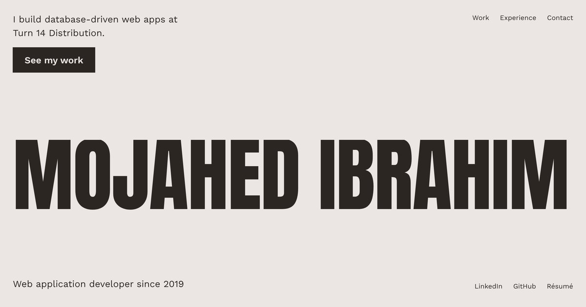

# Mojahed Ibrahim — Portfolio

Source for [mojahedsportfolio.com](https://mojahedsportfolio.com/): a single-page
portfolio with my experience, projects, résumé, and a contact form.



## Tech stack

- [React 18](https://react.dev/) + [Vite](https://vite.dev/)
- Hand-written CSS (no UI kit). Art direction dealt with [taste-skill](https://github.com/leonxlnx/taste-skill)
  ("Type and nothing else": Anton + Work Sans, rose grey / ink / green), checked with its inspector and
  [impeccable](https://github.com/pbakaus/impeccable)'s craft floor
- Fonts self-hosted via Fontsource
- Contact form posts to my own Java Spring Boot API
  ([telegramApi](https://github.com/mibrahim95/telegramApi)), which validates the
  message and forwards it to Telegram

## Getting started

Requires Node.js 20.19+ or 22.12+ (see `.nvmrc`).

```bash
npm install
npm run dev        # http://localhost:3000
```

| Script            | What it does                                   |
| ----------------- | ---------------------------------------------- |
| `npm run dev`     | Start the dev server with hot reload           |
| `npm run build`   | Production build into `build/`                 |
| `npm run preview` | Serve the production build locally             |
| `npm run lint`    | Run ESLint                                     |

## Configuration

Create a `.env.local` file (it is git-ignored):

```bash
REACT_APP_API_HOST=https://your-api.example.com/contact
# Optional. Sent as HTTP Basic auth to the contact API.
REACT_APP_JAVA_API_USERNAME_AND_PASS=username:password
```

> **Note:** every `REACT_APP_*` / `VITE_*` variable is compiled into the public
> JavaScript bundle and can be read by anyone. Do not treat the Basic auth value
> as a secret; protect the API itself (rate limiting, CAPTCHA, origin checks).

## Editing content

All page content lives in JSON, so most updates need no code changes:

- `src/json/summaryData.json` — the intro bullet points
- `src/json/expList.json` — work experience
- `src/json/projects.json` — project cards (`imgPath`, `github` and `url` are optional)

Images live in `public/`. Keep screenshots around 800px wide (4:3 works best) and in WebP format.
Found pictures and their licences are recorded in `public/assets/credits.json`.
